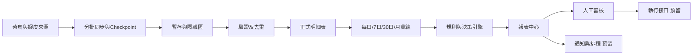

# 後續模塊預留與報表中心藍圖

## 定位

現有原型繼續負責資料驗證與決策規則。正式系統在其外層增加同步、品質、報表、審核及通知接口，形成以下固定流程：



報表中心只讀正式表及彙總表，不直接讀取整頁HTML、全量JSON或瀏覽器狀態。報表生成失敗不影響每日同步，報表也不能直接修改店鋪。

## 後續預留模塊

| 模塊 | 用途 | 現況 | 啟用條件 |
|---|---|---|---|
| 資料同步編排 | 管理D-1、D-3回補、每週核對和歷史續跑 | 原型可用 | 定時任務啟用後正式化 |
| 資料品質中心 | 缺日、重複Key、未配對、異常負值和來源差異 | 部分可用 | 將現有驗證統一成每日結果 |
| 商品生命週期 | 零瀏覽、低轉換、上下架候選和版本歷史 | 藍圖完成 | 累積至少30天商品觀測 |
| 廣告決策 | 單品、群組、商品層擴量／維持／精簡／停投候選 | 原型可用 | 補成本後加入盈利門檻 |
| 組合與加價購 | 關聯商品、主商品、加購品、測試價格和風險 | 原型可用 | 訂單品項和成本資料可用 |
| 促銷效果 | 折扣、組合、優惠券前後比較 | 資料來源部分可用 | 活動成效及訂單折扣分攤確認 |
| 成本與利潤 | 商品成本、平台費、物流費、損益平衡ROAS | 關閉 | 成本資料源及生效日期確認 |
| 庫存與物流 | 安全庫存、缺貨、超材、同箱風險 | 關閉 | 庫存、重量和尺寸來源確認 |
| 訂單與取件提醒 | 已出貨、到店日起超過4天未取提醒 | 原型可用 | 排程及通知接口啟用 |
| 實驗追蹤 | 記錄改價、換圖、調預算、促銷測試前後結果 | 預留 | 人工動作可被可靠記錄 |
| 行動審批與稽核 | 建議、審核人、執行時間、前後值及回滾資訊 | 預留 | 開始實際修改店鋪前必須啟用 |
| 多店鋪與權限 | 同一框架接入其他店鋪並隔離資料 | Key已預留 | 第二家店接入時啟用 |
| 排程與通知 | 日報、異常提醒、失敗通知 | 接口預留 | 使用者確認頻率和通知渠道 |

## 報表中心結構

```text
store-audit/
  config/report-registry.json       報表目錄與啟用條件
  reporting/
    README.md                       模塊契約
    sql/001-reporting-schema.sql    預留資料表，不自動套用
    validate-report-registry.cjs    設定檢查
    templates/                      未來HTML/PDF模板
  reports/
    <report_key>/<period>/<run_id>/
      report.json                   機器可讀結果
      report.md                     人工審核版本
      report.csv                    需要逐列審核時產生
      manifest.json                 來源、版本、雜湊及完整性
```

每一份報表都必須保存：`store_id`、賣場展示名稱、報表Key、定義版本、期間、資料截止時間、資料狀態、規則版本、來源指紋、生成時間及完整性結果。

## 第一版報表目錄

| 報表 | 頻率 | 核心內容 | 明細上限 |
|---|---|---|---:|
| 營運總覽日報 | 每日 | 昨日銷售、廣告、商品、促銷、取件和資料品質 | 每區5項 |
| 廣告D-1日報 | 每日 | 單品與群組花費、轉換、ROAS、優先處理項 | 20項 |
| 廣告7日趨勢 | 每日 | 趨勢、連續異常、擴量和衰退候選 | 20項 |
| 廣告月報 | 每月 | 月花費、營收、ROAS、狀態變化和Top項目 | 20項 |
| 商品流量30日報 | 每週 | 零瀏覽、低瀏覽、高瀏覽低轉換和下架候選 | 20項 |
| 組合／加價購候選 | 每週或按需 | 主商品、加購品、理由、價格、風險和測試順序 | 20組 |
| 促銷成效報告 | 活動結束後 | 活動前後銷售、客單價、件單數及增量 | 20項 |
| 取件提醒 | 每日 | 到店超過4天且仍未送達的訂單 | 20單 |
| 資料品質報告 | 每日 | 缺日、重複、未配對、來源差異和同步錯誤 | 20項 |
| 蝦皮規則變更 | 每週 | 官方規則來源、變更日期、影響模塊 | 20條 |
| 利潤報告 | 每日／每月 | 毛利、貢獻利潤、損益平衡ROAS | 關閉 |
| 庫存風險報告 | 每日 | 缺貨、低庫存及廣告仍投放商品 | 關閉 |

## 報表固定版面

1. 報表身份：賣場、期間、資料截止時間、資料是否暫定。
2. 核心指標：最多8個指標，顯示與上一期間差異。
3. 需要行動：最多20項，包含ID、理由、風險、建議及證據期間。
4. 機會項目：最多20項，與問題項分開。
5. 資料品質：缺失、未配對、延遲歸因及來源限制。
6. 執行狀態：未執行、待審核、已批准、已執行或已回滾。
7. 追溯資訊：規則版本、來源指紋、run_id和生成時間。

## 報表狀態

- `provisional`：D-1或當日資料，可能受延遲歸因影響。
- `revised`：完成D-3回補後數據有變更。
- `final`：期間已關閉並通過完整性核對。
- `partial`：來源缺失、同步中斷或只完成部分範圍。
- `blocked`：必要資料源尚未接入，例如成本報告。

狀態必須顯示在報表首屏，禁止用部分資料生成看似完整的結論。

## 防卡與長期保存

- 模型只讀摘要JSON及最多20項行動，不讀報表完整明細。
- 報表按`report_key + period + source_fingerprint + definition_version`快取；來源未變不重算。
- 日報保留每日JSON與Markdown；月報只讀月彙總，不重新掃描半年日明細。
- CSV只在需要人工篩選時生成；HTML及PDF由同一份`report.json`渲染。
- 原始資料、計算結果及展示模板分離，修改版面不重抓蝦皮資料。
- 半年報預設只讀6筆月彙總；需要下鑽時按ID另查最多20項。

## 實作順序

1. 先啟用資料品質報告與廣告D-1日報，驗證報表契約。
2. 將現有廣告分析輸出接入報表中心，不重寫分析邏輯。
3. 建立營運總覽日報，引用各模塊摘要。
4. 接入商品流量、組合／加價購和取件提醒。
5. 成本資料完成後啟用利潤報告。
6. 使用者確認後再啟用排程、通知和行動審批；不直接自動修改店鋪。
